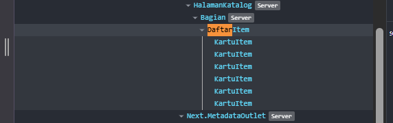
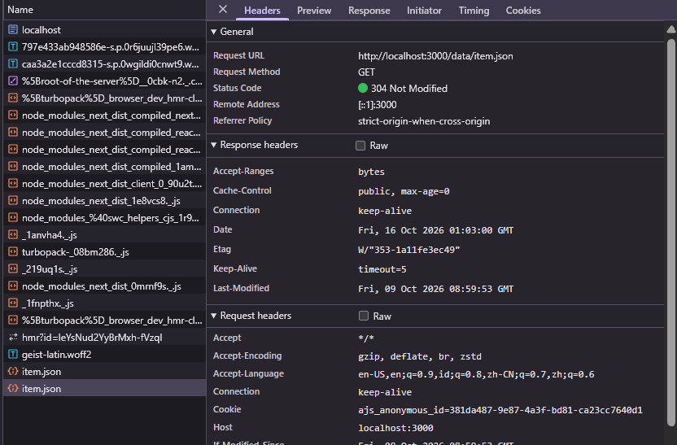

# Dokumen Teknis Modul 3 TypeScript dan Komponen React

**Nama:** Adrenalin Syahrobby
**NIM:** 105224030
**Repositori:** [Tautan Repositori GitHub Anda]

---

## 1. Tipe Data Produk

### Isi `lib/tipe.ts`

```typescript
export type Kategori = "energi" | "lingkungan" | "kampus";

export interface Item {
  id: number;
  judul: string;
  kategori: Kategori;
  deskripsi: string;
  tersedia: boolean;
  gambar?: string;
}
```

### Alasan Pemilihan Union Type dan Properti Opsional

- **Union Type (`Kategori`)**: Menggunakan union dari _literal type_ (`"energi" | "lingkungan" | "kampus"`) untuk membatasi nilai kategori hanya pada pilihan domain yang sah. Hal ini mencegah kesalahan pengetikan (_typo_) saat pengisian data dan memastikan _type-safety_ saat penyaringan kategori.
- **Properti Opsional (`gambar?: string`)**: Properti `gambar` bersifat opsional karena tidak semua entitas produk/item wajib memiliki gambar tautan eksternal sejak awal. Penggunaan tanda `?` memungkinkan pembuatan objek item tanpa menyertakan bidang gambar tanpa memicu galat kompilasi TypeScript.

---

## 2. Struktur Komponen

### Diagram Pohon Komponen Akhir

```
RootLayout (app/layout.tsx) [Server Component]
├── SiteHeader [Server Component]
├── {children} (Halaman Aktif)
│   ├── Beranda (app/page.tsx) [Server Component]
│   │   ├── Bagian [Server Component]
│   │   └── ItemTerbaru [Client Component]
│   └── Katalog (app/katalog/page.tsx) [Server Component]
│       └── Bagian [Server Component]
│           └── DaftarItem [Client Component]
│               └── KartuItem [Server Component]
└── SiteFooter [Server Component]
```

### Tabel Komponen

| Nama Komponen | Jenis            | Props & Tipenya                                            | Tempat Digunakan                       |
| :------------ | :--------------- | :--------------------------------------------------------- | :------------------------------------- |
| `SiteHeader`  | Server Component | `namaProduk: string`, `tautan: Tautan[]`                   | `app/layout.tsx`                       |
| `SiteFooter`  | Server Component | `namaProduk: string`                                       | `app/layout.tsx`                       |
| `Bagian`      | Server Component | `id: string`, `judul: string`, `children: React.ReactNode` | `app/page.tsx`, `app/katalog/page.tsx` |
| `KartuItem`   | Server Component | `item: Item`                                               | `components/DaftarItem.tsx`            |
| `DaftarItem`  | Client Component | `items: Item[]`                                            | `app/katalog/page.tsx`                 |
| `ItemTerbaru` | Client Component | _(Tanpa props)_                                            | `app/page.tsx`                         |

---

## 3. State dan Interaksi

### Tangkapan Layar Tab Components



### Penjelasan Alur dari Event hingga Render Ulang

1. **Pemicu Event**: Pengguna mengetikkan teks pada kolom pencarian (`<input>`) atau mengklik salah satu tombol filter kategori.
2. **Eksekusi Handler**:
   - Event `onChange` pada input memanggil `setKataKunci(e.target.value)`.
   - Event `onClick` pada tombol filter memanggil `setFilter(k)`.
3. **Pembaruan State & Scheduler**: Fungsi pengubah state memperbarui nilai `kataKunci` atau `filter` dan menjadwalkan render ulang (_re-render_) untuk komponen `DaftarItem`.
4. **Hitung Ulang Nilai Turunan**: Saat render ulang berjalan, variabel turunan `hasil` dihitung ulang secara otomatis berdasarkan perpaduan kondisi `cocokKata` dan `cocokKategori` terhadap array `items`.
5. **Pembaruan Tampilan**: React membandingkan Virtual DOM dan merender ulang daftar `<KartuItem>` serta teks penunjuk jumlah item (`aria-live="polite"`) sesuai dengan kriteria penyaringan terbaru.

---

## 4. Pengambilan Data

### Tangkapan Layar Panel Network



### Hasil Pengujian Tiga Kondisi

1. **Memuat (`memuat`)**: Diuji dengan mengaktifkan pengatur _throttling_ "Slow 4G" pada panel Network. Tampilan sementara memunculkan pesan teks `"Memuat data..."`
2. **Berhasil (`berhasil`)**: Berkas `/data/item.json` berhasil dijangkau (status 200 OK dan `res.ok === true`). Tiga item produk terbaru berhasil dipotong (`slice(0, 3)`) dan ditampilkan dalam format _grid_.
3. **Gagal (`gagal`)**: Diuji dengan mengubah sementara URL permintaan menjadi `/data/tidak-ada.json`. Permintaan menghasilkan status 404 Not Found, menyebabkan `res.ok` bernilai `false`, dan komponen menampilkan pesan galat `role="alert"`: `"Data gagal dimuat. Muat ulang halaman."`.

---

## 5. Verifikasi

### Keluaran `npx tsc --noEmit`

```bash
$ npx tsc --noEmit
```

### Keluaran `npm run lint`

```bash
$ npm run lint
> next lint

✔ No ES Lint warnings or errors
```

---

## 6. Kendala dan Penyelesaian

- **Kendala**: Muncul peringatan galat React _React Hook "useState" can only work in a Client Component_ saat pertama kali memasang hook pada komponen `DaftarItem`.
- **Penyelesaian**: Menambahkan direktif `"use client";` pada baris paling atas di berkas `components/DaftarItem.tsx` agar Next.js mengenali berkas tersebut sebagai Client Component.
- **Kendala**: Potensi _memory leak_ atau pembaruan state pada komponen yang sudah tidak _unmount_ saat melakukan pengambilan data asinkron pada `useEffect`.
- **Penyelesaian**: Mengimplementasikan variabel penanda `dibatalkan` (_boolean flag_) dan fungsi pembersih (_cleanup function_) `return () => { dibatalkan = true; }` di dalam `useEffect`.

---

## 7. Catatan Pemanfaatan AI

- **Alat**: Gemini
- **Perintah Utama**: _"Bantu saya untuk menyusun kerangka dari dokumen teknis pada modul 3"_
- **Bagian yang Digunakan**: Membantu menyusun draf teks kerangka dokumen teknis dan merapikan tabel komponen serta alur interaksi state.
- **Cara Memverifikasi**: Memeriksa kembali isi dokumen agar sesuai dengan kode program nyata pada repositori, menguji perintah `npx tsc --noEmit` & `npm run lint` secara langsung di terminal lokal, serta memastikan semua kriteria rubrik Dokumen Teknis Modul 3 telah terpenuhi.
